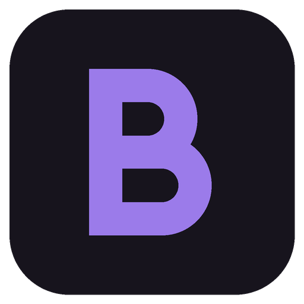

# BooVI

[English](README_EN.md)

BooVI est une app Windows de streaming de jeu : PS5 en Lecture à distance, Xbox, PC (Moonlight)
et cartes d'acquisition. Ta carte graphique améliore l'image reçue (super résolution, génération
d'images) avec une latence basse.

## Ce que ça fait

- **PS5** : Lecture à distance sur le réseau local, manette DualSense avec gyroscope, pavé tactile et vibrations.
- **Xbox** : streaming depuis ta console (non officiel).
- **PC** : client Moonlight pour un hôte Sunshine.
- **Carte d'acquisition** : affiche et améliore l'entrée HDMI.
- **Super résolution** : DLSS, FSR, RTX Video.
- **Génération d'images** : DLSS Frame Generation, FSR 3.1, NVIDIA Video Frame Generation.
- **Latence basse** : présentation au rythme de l'écran, G-SYNC et Reflex sur NVIDIA.
- **Clavier et souris vers manette** : jouer à la PS5 sans manette.
- **Enregistrement** de la session.
- **Jouer à distance avec un ami** : tu partages ta session, ton ami la rejoint avec un lien.

## Configuration

- Windows 10 ou 11, 64 bits.
- Une carte graphique DirectX 12 et un pilote récent.
- NVIDIA RTX : DLSS (RTX 20 et plus), DLSS Frame Generation (RTX 40 et 50).
- AMD, Intel et autres : FSR 3.1 pour la super résolution et la génération d'images.

## Télécharger

Va dans [Releases](../../releases) et prends `BooVI-<version>-win64-portable.zip`. Pas d'installateur.

1. Décompresse le dossier où tu veux, sauf dans `Program Files` (par exemple sur le Bureau).
2. Lance `BooVI.exe`. Windows SmartScreen peut demander « Exécuter quand même ».

Les réglages restent dans le dossier de l'app. Les associations de consoles et les secrets de
partage sont chiffrés pour ton compte Windows dans `%LOCALAPPDATA%\BooVI`.

## Démarrage rapide : PS5

1. Sur la PS5 : **Paramètres → Système → Lecture à distance**, active la Lecture à distance.
2. Dans BooVI : **consoles → PS5**. Allume la PS5 ou laisse-la en mode repos ; BooVI la trouve
   sur ton réseau local. Sinon, entre son adresse IP.
3. **Associer, une seule fois** : il faut l'Account ID de ton compte PSN (**trouver mon id**
   ouvre un site qui le donne), puis le code à 8 chiffres affiché par la PS5 dans
   **Lecture à distance → Associer un appareil**.
4. Si la PS5 demande le code de connexion de ton compte (PIN), BooVI peut le retenir, chiffré sur ce PC.
5. **Jouer**.

Manette :

- **Déconnecte d'abord ta DualSense de la PS5** (éteins-la en maintenant le bouton PS une
  dizaine de secondes), sinon elle pilote la console directement et BooVI ne la voit pas.
- Branche-la en USB ou associe-la en Bluetooth au PC.
- Sans manette, le clavier et la souris pilotent une manette virtuelle.

## Jouer à distance avec un ami

Pendant une session, **partager** crée un lien. Ton ami le colle dans BooVI (**accueil →
rejoindre un partage**) ou l'ouvre dans Chrome ou Edge. Chez lui, sa carte graphique fait la
super résolution et la génération d'images.

Le lien passe par l'un de ces chemins, au choix dans **réglages → partage** :

- **Broker** (par défaut) : un lien `https://…/<salon>#t=…`, rien à installer ; l'image passe en direct entre vous deux.
- **Tailscale** : vous êtes tous les deux dans le même tailnet.

Voir [docs/SHARING.md](docs/SHARING.md).

## Compiler

Voir [docs/DEVELOPMENT.md](docs/DEVELOPMENT.md) (en anglais).

## Licence

GPLv3, voir [LICENSE](LICENSE). La partie PS5 utilise [chiaki-ng](https://github.com/streetpea/chiaki-ng)
(AGPL-3.0). Les composants tiers et leurs licences sont listés dans
[THIRD_PARTY_NOTICES.md](THIRD_PARTY_NOTICES.md) et `licenses/`.

Basé sur [Veyra](https://github.com/Likely7/Veyra-NRVideo), GPLv3.

PlayStation, PS5 et DualSense sont des marques de Sony Interactive Entertainment. Xbox est une
marque de Microsoft. BooVI n'est affilié à aucune des deux.
